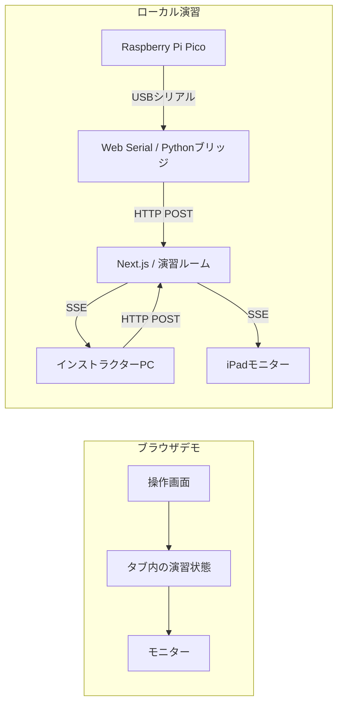

# SimMonitor

SimMonitorは、除細動器の操作と心電図モニターの反応を体験する医学教育・訓練用シミュレーターです。専用機材なしで試せるブラウザデモと、PC・iPad・Raspberry Pi Picoを使うローカル演習に対応しています。

医学部で学ぶ中で、調律の変化と機器操作を一つの演習として確認できる環境を目指しました。このリポジトリでは、既存のシミュレーターを独立して起動できるように整理し、波形描画、画面間同期、物理ボタンとの連携を紹介します。

## デモとスクリーンショット

- 公開デモURLは準備中です。ローカルでは [http://localhost:3000/demo](http://localhost:3000/demo) で試せます。
- TODO。デモ画面とPico連携画面のスクリーンショットを、表示確認後に追加します。

「デモを開始」から、`CHARGE`、準備完了、`SHOCK` の順に操作すると、模擬波形と操作履歴の変化を確認できます。デモは1タブで完結し、無音です。iPadとの同期と音声はローカル演習で利用できます。

## 主な機能

- Canvasで正常洞調律やVFなどの波形を表示し、心拍数、誘導、感度、充電状態を更新
- プリセットとタイムラインによる演習。波形の切り替えや、設定条件に達する模擬ショックを待つイベントを設定
- インストラクター画面で演習を操作し、iPadモニターへ状態を配信
- Picoのロータリースイッチ、ボタン、パドル、電極判定の入力を反映

## 技術スタック

| 技術 | 用途 |
| --- | --- |
| Next.js App Router、React、JavaScript | 役割別画面、接続UI、同一オリジンの操作・状態API |
| HTTP、Server-Sent Events（SSE） | PCからの操作を送信し、演習状態をiPadなどの画面に配信 |
| Canvas 2D、Web Audio | 波形の合成・掃引と、ローカル演習の拍動音・警報音などの再生 |
| CircuitPython、MCP23017、ADC | Picoでスイッチとアナログ入力を読み取り、USBシリアルで出力 |
| Web Serial、Python、pyserial | PCでPicoのシリアル入力を読み取り、共通の操作APIに転送 |
| TypeScript、ESLint、Node.jsテストランナー | JavaScriptの一部をJSDocとともに型検査し、静的解析と回帰検証を実行 |

## アーキテクチャ



### 技術的な工夫

- ブラウザデモとローカル演習で、充電・模擬ショック・シナリオの状態遷移を共用しています。
- SSEで共有するのは演習状態です。Canvasはモニター端末で波形を生成し、掃引が進んだ領域を描き直します。
- Picoと画面操作は同じ操作名を使います。Pythonブリッジの再送には操作IDを付け、同じ操作の二重適用を防ぎます。

## ディレクトリ構成

| 場所 | 内容 |
| --- | --- |
| `src/app/` | Next.jsの画面とAPI |
| `src/features/simulator/` | 画面、ブラウザデモ、Canvas、音声、Web Serial |
| `src/lib/simulator/` | 状態遷移、ルーム、HTTPクライアント、共有型 |
| `hardware/` | Picoファームウェア、診断、PC用Pythonブリッジ |
| `public/sim-monitor/audio/` | ローカル演習の音源 |
| `demo/`、`scripts/` | 静的デモの入口とビルド |
| `docs/`、`tests/` | 技術資料と回帰テスト |

## インストール・起動

Node.js 20.9以降で実行します。

```sh
npm ci
npm run dev
```

[http://localhost:3000](http://localhost:3000) から「デモを開く」または「新しい演習を開く」を選びます。ローカル演習では、PCと同じネットワーク上のiPadで、インストラクター画面に表示されたモニターURLを開きます。Picoがない場合は、Scenarioから演習を開始できます。モニター音は、電源を入れた後に右上のボタンから有効にします。

- 本番用のローカルサーバーは `npm run build` の後に `npm start` で起動します。
- 公開デモ用の静的ファイルは `npm run build:demo` で `out/` に生成します。公開設定は [静的デモの設計と公開範囲](docs/design.md#静的デモの公開) を参照してください。
- 確認コマンドは `npm run typecheck`、`npm run lint`、`npm test` です。

## Pico連携

PicoはインストラクターPCにUSB接続します。Chrome・EdgeでPCの `http://localhost:3000` を開き、「Picoを接続」からポートを選びます。Pythonブリッジを使う場合は、同じPCで起動し、画面に表示された接続IDを渡します。配線・校正・セットアップは [Picoの接続ガイド](hardware/pico/README.md) を参照してください。

演習URLには、状態の参照と操作に使う接続IDが含まれます。ローカル演習サーバーは信頼できるネットワーク内で運用し、URLは参加端末に共有してください。状態はサーバーのメモリに保持され、再起動で消去されます。

詳しくは [システム設計](docs/design.md)、[通信仕様](docs/protocol.md)、[状態遷移](docs/state.md) を参照してください。

## 今後の改善

- 実画面のスクリーンショットとiPad・Pico実機での検証結果を追加
- シナリオ編集の回帰テストとJSDocによる型検査の対象を拡充
- コピー元コード・音源・意匠の公開範囲と再配布条件を確認

## 免責事項

本システムは医学教育・シミュレーションを目的としています。実際の医療機器としての機能を備えておらず、臨床上の判断や患者への治療には使用できません。表示する波形と数値は模擬データです。特定メーカーの公式製品・公認シミュレーターではありません。
