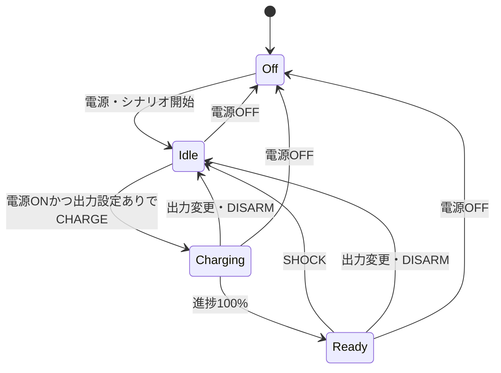

# シミュレーションの状態遷移

## 機器状態

模擬充電の進捗は120 msごとに8ポイントずつ進みます。準備完了前のSHOCKは適用されず、履歴に記録されます。電源OFFで充電とタイムライン進行を停止します。

AED・PACINGはロータリー位置、SYNCは切替状態として扱います。AED自動解析、実際のペーシング動作、波形に同期したショック判定は実装していません。

## シナリオ

- **プリセット**。最初の調律・バイタル・出力を設定し、ショック回数に応じてシナリオに定義された調律とバイタルへ移ります。
- **タイムライン**。波形イベントの後に別の波形が続く場合は、設定時間で進みます。次がショック待機イベントの場合は待機に入り、設定出力以上の模擬ショックで次に進みます。最後が波形のときはその表示を維持します。先頭にショックを置く構成と、ショックが連続する構成は受理しません。
- **シナリオ外のショック**。機器が準備完了状態であれば演習用の規則を適用します。例として、VFを洞調律へ切り替えます。

これらは教育用の模擬挙動です。実際の患者データや治療判断の規則には使用できません。
